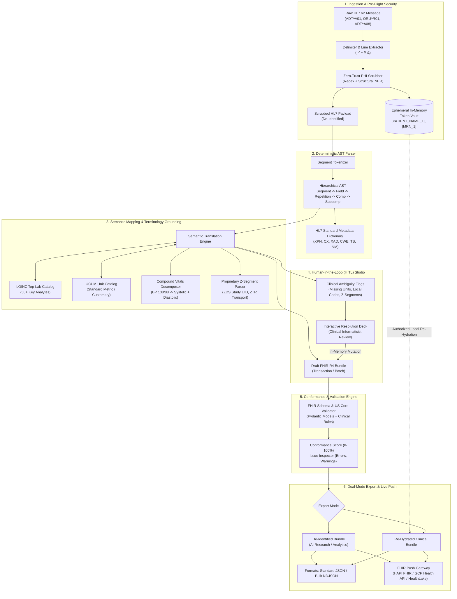

# System Architecture & Technical Design

## 1. Executive Summary

**SemantiCare** is an enterprise-grade healthcare interoperability platform designed to ingest legacy Health Level Seven (HL7) version 2.x clinical messages and translate them into HL7 Fast Healthcare Interoperability Resources (FHIR) Release 4 (R4) JSON Transaction Bundles compliant with the **US Core Implementation Guide (v3.1.1 / v6.1.0)**.

The system solves the fundamental tension between legacy EHR data idiosyncrasies (missing metadata, local code vocabularies, compound readings, custom hospital Z-segments) and strict modern regulatory standards (ONC 21st Century Cures Act, USCDI v1-v3) by implementing a **Hybrid Rules-First + Grounded Semantic Mapping + Human-in-the-Loop (HITL)** architecture.

---

## 2. High-Level Architecture Diagram

---

## 3. Core Architectural Subsystems

### 3.1. Zero-Trust Security & Ephemeral Token Vault
Healthcare interoperability demands strict privacy. Sending raw protected health information (PHI) to external machine learning endpoints or logging pipelines violates HIPAA and GDPR.

* **Pre-Flight Scrubber (`app/security/phi_scrubber.py`)**:
  * Scans sensitive HL7 fields (`PID-3` MRN, `PID-5` Name, `PID-7` Date of Birth, `PID-11` Address, `PID-13` Phone, `PID-19` SSN, `NK1-2` Next of Kin Name, `PV1-7` / `PV1-8` Provider Names and NPIs).
  * Replaces each entity with a deterministic synthetic token (e.g., `[PATIENT_FAMILY_NAME_1]`, `[MRN_1]`).
* **Ephemeral In-Memory Token Vault**:
  * An isolated in-memory Python `TokenVault` maintains bidirectional mappings between synthetic tokens and authentic values.
  * Tokens are never persisted to disk or sent across unencrypted external interfaces.
* **On-Demand Re-Hydration**:
  * When a clinical operator selects "Re-Hydrated Export", the vault traverses the final FHIR JSON tree in-memory, replacing surrogate tokens with real patient data immediately prior to client download or authenticated FHIR store submission.

---

### 3.2. Deterministic Structural HL7 v2 AST Parser
HL7 v2 is a non-XML, delimiter-based standard with notorious real-world deviations.

* **Dynamic Delimiter Extraction (`app/core/hl7_parser.py`)**:
  * Rather than assuming standard delimiters, the parser extracts the five delimiter characters directly from bytes 4 through 8 of the `MSH` header:
    * Field Separator: `|` (ASCII 124)
    * Component Separator: `^` (ASCII 94)
    * Repetition Separator: `~` (ASCII 126)
    * Escape Character: `\` (ASCII 92)
    * Subcomponent Separator: `&` (ASCII 38)
* **Hierarchical AST Decomposition**:
  * The raw text is decomposed into a strict Abstract Syntax Tree (AST):
    $$\text{Message} \longrightarrow \text{Segments} \longrightarrow \text{Fields (1-indexed)} \longrightarrow \text{Repetitions} \longrightarrow \text{Components} \longrightarrow \text{Subcomponents}$$
* **HL7 Metadata Dictionary (`app/core/hl7_dictionary.py`)**:
  * Defines standard definitions and descriptions for standard segments (`MSH`, `EVN`, `PID`, `PV1`, `ORC`, `OBR`, `OBX`, `NTE`, `DG1`, `IN1`, `NK1`, `AL1`).
  * Annotates complex data types including `XPN` (Person Name), `CX` (Composite ID), `XAD` (Address), `CWE` (Coded Entry), `TS` (Timestamp), and `NM` (Numeric).
  * Detects proprietary custom hospital segments (`Z..`) such as `ZDS` (DICOM Study) and `ZTR` (Patient Transport).

---

### 3.3. Grounded Semantic Mapping Engine
To ensure clinical validity and eliminate hallucination, semantic mapping combines deterministic structural routing with grounded ontology lookup:

* **Resource Dispatching (`app/engine/mapper.py`)**:
  * `PID` + `NK1` $\longrightarrow$ **`Patient`** (with US Core race/ethnicity extensions, identifier systems, contacts).
  * `PV1` $\longrightarrow$ **`Encounter`** (with class mapping `IMP`/`AMB`/`EMER`, service provider, attending practitioner).
  * `OBR` + `OBX` + `NTE` $\longrightarrow$ **`DiagnosticReport`** and **`Observation`** (with laboratory vs vital signs category codes, abnormal flags, reference intervals).
  * `DG1` $\longrightarrow$ **`Condition`** (ICD-10-CM coding, active clinical status, `encounter-diagnosis` category).
  * `IN1` $\longrightarrow$ **`Coverage`** (commercial and government payers, subscriber and policy IDs).
  * `ZDS` / `ZTR` $\longrightarrow$ Custom structured FHIR extensions.
* **Compound Measurement Handling**:
  * Clinical vitals monitors frequently emit composite values such as `138/88` in a single `OBX-5` field.
  * The engine decomposes composite blood pressure readings into standard US Core Blood Pressure multi-component observations:
    * Component 1: LOINC `8480-6` (Systolic blood pressure, `mm[Hg]`).
    * Component 2: LOINC `8462-4` (Diastolic blood pressure, `mm[Hg]`).
* **Terminology Grounding Engine (`app/terminology/loinc_catalog.py`)**:
  * Encapsulates top LOINC laboratory analytes and vital signs codes.
  * Employs token-based fuzzy matching to ground hospital-specific proprietary codes (e.g. `BP_LOCAL` $\rightarrow$ LOINC `85354-9`).
  * Verifies units against the Unified Code for Units of Measure (UCUM) specification.

---

### 3.4. Human-in-the-Loop (HITL) Resolution Deck
When clinical data lacks essential semantic attributes, pure automation risks silent clinical errors. The HITL deck surfaces uncertainties explicitly:

* **Ambiguity Detection**:
  * **`MISSING_UNIT`**: Numeric `OBX` where unit (`OBX-6`) is empty (e.g., patient weight `82.5`).
  * **`LOCAL_TERMINOLOGY`**: Observation with local non-LOINC test code.
  * **`CUSTOM_Z_SEGMENT`**: Hospital-specific proprietary segments.
  * **`COMPOUND_VALUE`**: Composite vital readings requiring clinical validation.
* **In-Memory Dynamic Mutation**:
  * Informaticists select or input the correct value (e.g., confirming `kg` over `[lb_av]`).
  * The frontend mutates the draft FHIR bundle in-memory and dynamically recalculates the overall confidence score without requiring a full backend roundtrip.

---

### 3.5. Conformance Validation Subsystem
* **Dual-Profile Validation (`app/validator/fhir_validator.py`)**:
  * Evaluates bundles against both base **HL7 FHIR R4 Core** and **US Core 3.1.1** profile rules.
  * Validates mandatory elements (e.g., `Encounter.status`, `Observation.code`, `Observation.subject`, `Condition.code`).
  * Verifies referential integrity ensuring that every `subject.reference` and `encounter.reference` matches a declared resource ID within the transaction bundle.
---

### 3.6. Persistent Institutional Mapping Memory Subsystem (v1.1)
* **ACID Persistence Engine (`app/rules/mapping_memory.py`)**:
  * Utilizes Python's zero-dependency built-in `sqlite3` to maintain an institutional clinical knowledge base (`data/mapping_rules.db`).
  * Indexing on `(facility, rule_type, source_key)` provides sub-millisecond retrieval during message parsing loops.
  * Hierarchical resolution order: Facility-specific rule (`MSH-4` or `MSH-6`) $\rightarrow$ Global rule (`*`).
  * Usage tracking metrics (`applied_count`) record learning efficacy and institutional adoption.
* **Standard FHIR ConceptMap Generator**:
  * Programmatically serializes active institutional rules into standard HL7 FHIR `ConceptMap` resources.

---

### 3.7. Clinical Narrative Entity Extraction Subsystem (v1.1)
* **Unstructured Note Parsing (`app/nlp/clinical_ner.py`)**:
  * Ingests physician and pathologist free-text comments from `NTE` segments.
  * Extracts structured findings into `Condition` resources with ICD-10-CM coding.
  * Extracts drug allergies into `AllergyIntolerance` resources with RxNorm / SNOMED CT coding.
  * Converts physician care recommendations into `ServiceRequest` proposals.
  * Full provenance tagging (`nte-extracted`) ensures complete auditability back to specific HL7 segment lines.

---

## 4. Technology Stack Matrix

| Layer | Technology | Version | Purpose |
| :--- | :--- | :--- | :--- |
| **Backend Runtime** | Python | 3.12 / 3.14 | High-performance clinical data pipeline |
| **API Framework** | FastAPI | 0.115+ | Async REST API with automatic OpenAPI documentation |
| **Persistence (Memory)** | SQLite | 3.x (ACID) | Institutional Mapping Memory & learned rules database |
| **Validation Models** | Pydantic v2 | 2.10+ | Strict type validation and schema serialization |
| **HTTP Client** | HTTPX | 0.28+ | Async HTTP client for external FHIR server push |
| **Web Server** | Uvicorn / Gunicorn | 0.34+ | ASGI production server |
| **Frontend Framework** | React | 19.0 | Concurrent React architecture |
| **Language** | TypeScript | 5.7+ | End-to-end type safety |
| **Build Tooling** | Vite | 8.3+ | Sub-second HMR and optimized production bundling |
| **Styling** | Tailwind CSS | v4.0 | Modern utility-first design system |
| **Code Editor** | Monaco Editor | 0.52+ | Syntax-highlighted HL7 & JSON workspace |
| **Containerization** | Docker & Docker Compose | Multi-stage | Reproducible microservice packaging |
| **Reverse Proxy** | Nginx | Alpine | Static SPA serving & `/api` proxying |

---

## 5. Security & Regulatory Compliance

* **HIPAA Safe Harbor**: All pre-loaded clinical scenarios are de-identified synthetic test cases.
* **Zero PHI Leakage**: Patient identifiers are sanitized before any external transmission.
* **Non-Root Container Execution**: Docker containers run as an unprivileged user (`appuser`, UID 10001).
* **Network Isolation**: Backend and frontend containers communicate via private Docker bridge networks (`semanticare-network`).
